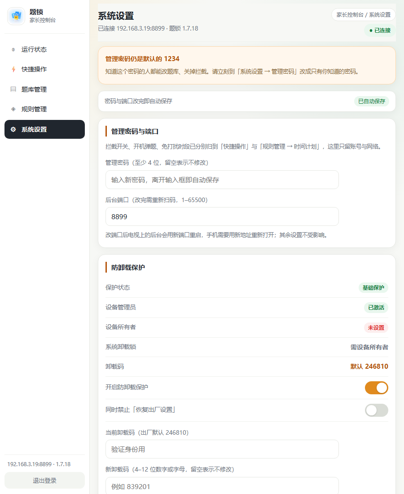

# 题锁（QlockOnTV）

安卓电视端强制答题管控应用：到点自动弹出小学语文 / 数学 / 英语选择题，答对全部题目才能继续看电视；题库和参数可用手机扫码在局域网后台修改。

## 界面预览

主要截图取自 **v1.7.22 / v1.7.21**：电视端为 MuMu 模拟器（Android 15）实机画面，后台为浏览器真实连接设备 8899 端口渲染（电脑 1440px / 平板 900px / 手机 500px 三档视口）。长答案自适应图为 v1.7.10 旧配色，仅用于说明功能。原图都放在 [`docs/screenshots/`](docs/screenshots/)。

> **v1.7.12 视觉更新**：参考开源项目 [chadyi/StudyOnTV](https://github.com/chadyi/StudyOnTV) 的界面语言——电视端改为近黑底 + 角落暖橙光晕 + 大圆角卡片 + 方块字母徽标（聚焦时橙色描边与外光），家长端后台改为米白底 + 纯白卡片 + 细边框的浅色管理台。**只改视觉，不动业务逻辑、接口和题库**。
>
> **v1.7.13 功能更新**：继续参考该项目，在手机后台新增独立的「管理规则」页（任务 / 时间 / 范围 / 复习 四个页签），把定时弹题升级为可配置的管控规则，详见下方「管理规则」章节。
>
> **v1.7.14 布局更新**：继续参考该项目的家长端骨架，管理后台改为左侧固定侧栏 + 右侧内容区的两栏布局（平板 / 电脑双列卡片，手机退化为顶部横滑导航）；同时把首页与规则页重复的「弹题间隔 / 每次题量 / 学科 / 年级」四项收归规则页，首页只留只读摘要，详见「管理后台布局」章节。
>
> **v1.7.15 导航整理**：把侧栏重建为「页面 / 本页内容」两层——左侧每一项都严格对应右侧一块内容，点击即定位并高亮，右上角面包屑同步显示当前位置；手机端收敛成一行横滑导航，不再出现重复的第二行页签。详见「管理后台布局」章节。
> **v1.7.16 单页五分区**：管理后台收成一页五个分区——左侧只有「运行状态 / 快捷操作 / 题库管理 / 规则管理 / 系统设置」五项，点哪一项右侧就只显示那一块；规则页的四个页签收进「规则管理」内部，不再占左侧导航。**所有设置改完自动保存**，页面里已无「保存设置」按钮；旧的 `/rules.html` 与 `#sec-*` 书签自动映射到新分区。详见「管理后台布局」章节。
>
> **v1.7.19 换肤**：后台与登录页统一换成「浅米绿底 + 圆角窗口外壳 + 细边框白卡 + 墨黑实心控件」的极简风——去掉橙色强调与重阴影，侧栏按「学习 / 系统」分组并改用线性图标，选中态统一为浅米色底；顶栏新增收起 / 展开侧栏按钮（记住上次状态）。详见「管理后台布局 → 视觉风格」。
>
> **v1.7.20 题库重做 + 年级标签**：电视端题目标签从「语文」改成「语文 · 3年级」；后台题库管理不再一次把 5 MB JSON 灌进页面，改成**分页列表（每页 20 条）+ 单题新增 / 编辑 / 删除 + 备份 / 导出**；顺手修掉一个会丢数据的 bug——旧版「载入当前题库 → 保存」会把全库年级抹平（接口没回 `grade` 字段）。详见「题库管理」章节。
>
> **v1.7.21 难度星级 + 错题按轮冷却 + 诗词复合题**：每道题新增 1–5 星难度，电视端标签变成「语文 · 3年级　★★★☆☆」，后台可按星筛选、单题改星；间隔重复改成**按轮冷却**——这一轮答错的题至少隔 3 轮（可调 1–20）才会再出现；语文里原先只问「作者」「朝代」「出自哪首诗」的 748 道单要素题，重写成「诗名 · 作者 · 朝代」「作者 · 朝代」「朝代 · 作者」和「诗句 — 作者 — 朝代 搭配判断」等 749 道复合题并轮换问法。详见「题库与年级」「管理规则 → 奖励与复习」。
>
> **v1.7.27 选项高度收紧 + 聚焦项自动入视野**：实机（1080p 电视）上四个答案卡片偏厚，加上底部反馈条后一屏放不下，最后一个选项被裁掉半截。选项卡片 `minHeight 72dp → 54dp`、上下内边距 `10dp → 7dp`、卡片间距 `8dp → 5dp`、行距 `5dp → 4dp`，题干上下留白与底部提示也一并收紧；另外给每个选项加聚焦监听并在反馈条出现后调用 `ensureVisible()`，当前选项始终完整滚入可视区，长答案换行时同样不会被底部提示压住。
>
> **v1.7.26 徽标垂直居中**：答案不管是 1 行还是 2 / 3 行，前面的 A/B/C/D 方块徽标都按**整个选项文字块**垂直居中，不再贴在第一行。根因是 `ReplacementSpan` 只在首行绘制，原先中心取的是首行 `(top+bottom)/2`；现在 `LetterSpan` 读取宿主 `TextView` 的 `Layout` 行数，多行时改用文本块高度的一半作为中心，单行保持原观感，字号缩放与护眼配色重绘后同样成立（悬挂缩进、文本契约、按钮高度都不变）。
>
> **v1.7.25 护眼配色**：后台「快捷操作」新增**护眼配色**卡片，5 套风格一键切换——米绿（默认）/ 羊皮纸 / 豆沙绿 / 雾蓝灰 / 夜间墨黑。家长后台全部页面（CSS 变量）与电视答题页（底色、题干、选项卡片、字母徽标、反馈色）同步换色，选择即保存、保存即生效，正在答题也不会重抽题。色板集中在 `Theme.java`，`/api/state` 下发色卡预览，`/api/settings` 保存并广播给答题页。夜间风格对侧栏选中态、KPI、进度条与雷达图网格等少数写死的浅底也单独压暗，不留白块。另修正**选中项边框不重合**：聚焦态原先多画一层外光并把卡片内缩 3dp，出现两圈框且边框比其它选项往里挪；现在默认 / 聚焦 / 按下三态共用同一边界、18dp 圆角、2dp 描边，只换填充与描边颜色，遥控器上下移动时边框完全重合、文字不位移。
>
> **v1.7.24 字号微调 + 缩放即时生效**：电视端题干 `38sp → 34sp`、选项 `28sp → 25sp`（约缩小 10%，带 `【题型名】` 的长题面一屏放得下），后台题库列表题干与编辑卡里的题干/选项也略微缩小；并修好**「学习页字号」改了不生效**——答题页是 `singleInstance` 且常被复用，原先只在创建时读一次 `fontScale`，现在保存规则后由 `Rules.save()` 发广播，正在答题的页面立即按新比例重画题干、选项与字母徽标（不重抽题、不打断答题），回到前台另有兜底重读；字号那行新增「预览效果」，先强制保存再弹一题看实际大小。
>
> **v1.7.23 题库扩充**：内置题库 19739 → **24704 题**，补齐语文 7 类题型（形近字辨析、错别字辨析、词义字义辨析、歇后语谚语、文言字词、诗词鉴赏、文学常识）与数学统计与可能性 / 位置与方向 / 时间与人民币、英语词汇语法真题；新增 806 道判断题，题干用 `【题型名】` 标注后「学习统计」自动多出对应题型。详见[题库扩充](#题库扩充v1723)。
>
> **v1.7.22 学习统计 + 行内编辑**：侧栏「规则管理」下面新增**学习统计**——按「科目 + 题型」累计答题与错题，出**横向柱状图排行 + 薄弱题型雷达图 + 明细表**，题型自动从题干判出来（拼音 / 古诗词 / 近义词 / 反义词 / 词语解释 / 计算 / 应用题 / 图形与公式 / 单位换算 / 单词词义 / 单词拼写 / 语法 …）。题库列表点「编辑」不再是滚到页面底部，而是**编辑表单直接展开在那道题下面**，保存或收起后自动归位。另附局域网装机脚本 `tools/tv_install.py`，一条命令给电视覆盖安装并回读版本，详见 [`docs/INSTALL-ON-TV.md`](docs/INSTALL-ON-TV.md)。
>
> **v1.7.18 设置归位**：系统设置页不再重复时间类设置——「免打扰时段」搬到「规则管理 → 时间计划」第一张卡（时间规则集中一处），「启用拦截」「开机立即弹一次题」搬到「快捷操作」与「自动弹题」并排，只剩管理密码与端口、防卸载保护；同时系统设置三张卡改为通栏（不再左右两栏）。

### 电视端

**家长信息页** — 首次安装，或在答题页连按 5 次「上键」并输入管理密码进入。左侧是扫码入口与首次配置速记，右侧是运行状态与权限提示，底部是始终可见的四个操作按钮。


**答题弹窗** — 每轮 5 题，按设定年级从语数英题库抽取，选项顺序每次打乱；答错先显示正确答案再换一组新题，全对后自动退回电视画面。


**答错反馈（v1.7.12）** — 正确项标绿、选错项标红，字母徽标同步变色，底部反馈卡片显示正确答案；反馈为空时卡片自动隐藏，四个短答案选项同屏完整可见。


**长成语解释（v1.7.10）** — 选项高度按文字自适应，长解释自动换行撑高，换行后与 A/B/C 标号后的正文悬挂对齐；题目与选项超出一屏时可滚动，答错反馈和操作提示固定在屏幕底部始终可见。


### 手机管理后台

v1.7.19 起整站换成「浅米绿底 + 圆角窗口外壳 + 细边框白卡 + 墨黑实心控件」的极简风，下面几张都是 MuMu 真机 1.7.19 的实拍。

**登录页** — 扫码后需先输入管理密码，登录态保留 12 小时。


**运行状态（电脑 1440px）** — 左侧只有「运行状态 / 快捷操作 / 题库管理 / 规则管理 / 系统设置」五项，点哪一项右侧就只显示那一块；默认进入只读的运行状态（拦截状态、当前弹窗、下次弹题、今日已弹、错题库、题库与防卸载概况），右上角面包屑同步显示当前位置。


**快捷操作（电脑 1440px）** — 左卡三个开关：启用拦截、是否开启自动弹题、开机立即弹一次题；右卡三个应急按钮：立即弹一次题 / 从现在重新计时 / 立即解锁；下方通栏「护眼配色」卡片（v1.7.25）有 5 个带色块预览的风格按钮。开关与风格改完自动保存，且都不重置「下次弹题」倒计时。


**规则管理（电脑 1440px）** — 任务与解锁 / 时间计划 / 答题范围 / 奖励与复习 四段收在同一分区内，用内容区顶部的分段按钮切换；免打扰时段也在这里（时间计划第一张卡）；改动自动保存，右上角徽标显示保存状态。


**系统设置（平板 900px）** — 通栏卡片：管理密码与端口、防卸载保护、保护说明与命令各占整行（v1.7.18 起不再左右两栏）；768–1023px 收窄侧栏、内容区单列。



**响应式（手机 500px）** — 侧栏退化成一行顶部横滑导航（品牌图标 + 五项 + 退出登录），当前项自动滚进视野；表单行改为「标签在上、控件在下」，规则四段仍用内容区内的分段按钮。


## 功能

| 功能 | 实现 |
| --- | --- |
| 开机自动后台运行 | `BootReceiver` 监听 `BOOT_COMPLETED` / `QUICKBOOT_POWERON`，拉起前台服务 `GuardService` |
| 定时强制弹窗 | `AlarmManager` 精确闹钟 + 15 秒轮询双保险，到点拉起 `QuizActivity` |
| 新系统后台弹窗 | Android 10+ 会拦后台启动界面（BAL），需授予「显示在其他应用上层」；API 34+ 另用 PendingIntent opt-in + 2.5 秒自检兜底 |
| 每次 N 道题（默认 5） | 语文 / 数学 / 英语按学科轮流抽题，选项顺序每次打乱 |
| 按年级出题 | 内置 24704 题（原 18000 题 + v1.7.11 追加 + v1.7.21 复合诗词题 + v1.7.23 扩充 4965 题），后台可只选三年级、多选 1–3 年级或全选；学科与年级交叉筛选 |
| 全部答对才关闭 | 答错先显示正确答案，停 4.5 秒后换一组全新随机题重新开始 |
| 关机逃避惩罚 | 弹窗未完成的状态写入 SharedPreferences，下次开机 2 秒内立刻补弹；另有「开机立即答题」开关 |
| 后台不允许退出 | 拦截返回键；按 HOME 逃到桌面会自动拉回（屏幕熄灭时不抢焦点） |
| 局域网更新题库 | 内置 HTTP 服务（默认 8899 端口），手机浏览器 / 微信扫码打开管理页 |
| 扫码后必须登录 | 未登录只能看到登录页；登录页提交密码换会话 Cookie（12 小时），未登录连 `/api/state`、题库都读不到 |
| 微信扫码进后台 | 电视端展示二维码（`http://电视IP:8899/`），微信「扫一扫」→ 输入管理密码 → 进入管理页 |
| 答题完自动收工 | 全部答对 → 界面自动关闭退回电视/桌面，守护服务继续在后台计时，不再停留在任何页面 |
| 家长远程放行（v1.7.4） | 手机后台「立即解锁」：关掉电视上正在显示的答题弹窗，孩子可正常看电视；等价于本轮由家长放行，下一轮从现在重新计时 |
| 品牌更名（v1.7.5） | 项目与产品名 **QlockOnTV**、中文 **题锁**；桌面图标标签、TV 横幅、通知、设备管理员文案、手机后台页面统一换新名 |
| 二维码默认不出现 | 只有**首次安装后第一次打开**会显示一次；之后只能靠遥控器隐藏手势（连按 5 次上键）+ 管理密码才会显示 |
| 隐藏管理入口 | 答题页**没有任何管理按钮或文字提示**；家长连按遥控器「上键」5 次（每次间隔 < 0.8 秒）才会弹出管理密码键盘 |
| 电视端无设置项 | 电视端只有答题页和只读信息页（二维码 + 状态）；所有参数只能手机改 |
| 遥控器操作 | 全部控件可 D-pad 聚焦，卸载码用屏幕数字键盘输入（老遥控器没有数字键也能用） |
| 防卸载 | 设备管理员 + 设备所有者（`setUninstallBlocked`）双层保护，卸载必须输入卸载码；只激活管理员仅有基础保护，彻底锁死需一次 adb，详见「防卸载」章节 |
| 卸载码提示修正（v1.7.6） | 卸载码对话框此前固定显示「请输入管理密码」，实际校验的是卸载码，家长容易输错；现按调用方显示「请输入卸载码 / 请输入管理密码」 |
| 激活设备管理员修复（v1.7.8） | 点「开启防卸载」后系统激活页一闪而过/毫无反应：跳转 Intent 误带 `FLAG_ACTIVITY_NEW_TASK`，Android 14+ 的 `DeviceAdminAdd` 会直接 `Cannot start ADD_DEVICE_ADMIN as a new task` 并结束。已改为普通启动，另加静默激活与 adb 命令两级兜底 |
| 深夜不自动亮屏（v1.7.9） | 后台新增「自动弹题总开关」与「免打扰时段」（支持跨午夜）：关掉总开关后取消所有闹钟，静默期内的闹钟改用不唤醒设备的 `RTC`，电视待机时不会再自己打开，详见「深夜不打扰」章节 |
| 长答案自适应（v1.7.10） | 选项按钮不再被 `weight` 强制平分固定高度：改为 `wrap_content` + 显式多行 + `minHeight` 保底，长成语解释完整换行显示；换行用 `LeadingMarginSpan` 悬挂对齐，题目与选项区可滚动，答错反馈和操作提示固定在屏幕底部 |
| 题库扩充（v1.7.11） | **只增不改**追加 1738 题：语文补足统编版 1–6 年级古诗文作者 / 朝代 / 出处 / 名句 / 古文寓意，数学补足图形公式与应用题（和差、等差数列、追及、相遇等），英语补足词形变化、语法、交际用语与句型转换。原有 18000 题逐字未改，详见「题库与年级」 |
| 界面风格（v1.7.12） | 参考 [chadyi/StudyOnTV](https://github.com/chadyi/StudyOnTV)：TV 端近黑底 + 暖橙光晕 / 渐变主按钮 / 大圆角卡片 / 方块字母徽标 + 橙色聚焦态；家长后台米白浅色卡片；反馈为空时自动隐藏让四个选项同屏。业务代码、HTTP 接口、题库数据均未改动 |
| 护眼配色（v1.7.25） | 后台「快捷操作」新增 5 套低刺激配色（米绿默认 / 羊皮纸 / 豆沙绿 / 雾蓝灰 / 夜间墨黑），家长后台全站与电视答题页一起换底色、文字、选项卡片、字母徽标和反馈色；选完立即生效并自动保存，正在答题不重抽题、不打断揭示。浅色三套避开纯白与高饱和，夜间套压低亮度与对比 |
| 选项紧凑布局（v1.7.27） | 选项卡片最小高度 54dp、卡片间距 5dp，四个答案 + 题干 + 底部反馈在 1080p 电视上一屏放得下；聚焦项与反馈条出现时自动滚入可视区，最后一个选项不再被裁掉或被提示文字压住 |
| 徽标垂直居中（v1.7.26） | 选项答案无论 1 行还是 2 / 3 行，A/B/C/D 方块徽标都落在整个文字块的垂直中心；不再贴在首行。徽标 span 读取宿主文本 Layout 的行数，单行保持原观感，字号缩放、换配色重绘后依然居中 |
| 管理规则（v1.7.13） | 手机后台新增独立规则页（任务 / 时间 / 范围 / 复习）：四种答题玩法与通关正确率、每日轮数上限、可用时段与 30 分钟格周计划、网课 / 家长豁免窗口、学科与年级范围、孩子自选题目难度、错题加练与错题复习、复习重置。参考 [chadyi/StudyOnTV](https://github.com/chadyi/StudyOnTV) 的规则模块，架构不支持的能力在页面内明确标注，详见「管理规则」章节 |
| 单页五分区后台（v1.7.14 → v1.7.16） | 参考 [chadyi/StudyOnTV](https://github.com/chadyi/StudyOnTV) 家长端骨架：左侧固定侧栏（品牌 / 五项导航 / 设备信息 / 退出登录）+ 右侧只显示当前那一块内容；≥1024px 双列卡片、768–1023px 窄侧栏单列、<768px 顶部横滑导航。运行状态只读、快捷操作放三个开关（启用拦截 / 自动弹题 / 开机弹题）与三个应急按钮、题库管理放分页题目列表与单题增删改、备份导出与导入、规则管理内含任务与解锁 / 时间计划 / 答题范围 / 奖励与复习四段、系统设置放管理密码与端口、防卸载保护（三张卡通栏）。所有开关、时间、规则改完自动保存（`keepDue` 不重置倒计时），题库与卸载码因需校验/防半截数据保留按钮。详见「管理后台布局」章节 |
| 难度星级 + 错题按轮冷却（v1.7.21） | 每题带 `difficulty`（1–5 星）：电视端标签「语文 · 3年级　★★★☆☆」，后台按星筛选 / 单题改星 / 难度分布；间隔重复改为按轮冷却（默认隔 3 轮，1–20 可调），本轮错题在冷却期内既不进优先复习也不被随机抽到；语文 748 道单要素诗词题重写为 749 道「诗名 · 作者 · 朝代」复合题，问法轮换、干扰项同年级错配。详见「题库与年级」「管理规则 → 奖励与复习」 |
| 学习统计（v1.7.22） | 每答一题按「科目 + 题型」累加一次（`StudyStats` + `QType` 分类器），后台「学习统计」出**横向柱状图**（错题数 / 错误率可切）、**雷达图**（最薄弱的 8 个题型）、全库明细表，支持按语文 / 数学 / 英语筛选与一键清空；只记答题结果，不记内容，换题库不丢统计 |
| 题目行内编辑（v1.7.22） | 题库列表点「编辑」时，编辑卡片整块搬到该题下方并高亮展开，保存 / 收起后自动回到原位；翻页、改筛选、切分区都会先收回，不会挂着一份改了一半的表单 |
| 局域网一键装机（v1.7.22） | `tools/tv_install.py`：扫描 192.168.x.0/24 找题锁设备 → `adb install -r` 覆盖安装 → 自动拉起 App 并回读 `appVersion`；电视关着网络调试时用 `--serve` 起局域网下载页，电视浏览器点一下即可装。详见 [`docs/INSTALL-ON-TV.md`](docs/INSTALL-ON-TV.md) |
| 统一品牌图标（v1.7.2） | 桌面图标、Android TV 横幅、手机管理后台三处共用 `assets/logo.png`；换图跑一次生成脚本即可 |

## 命名与升级兼容（v1.7.5）

项目更名为 **QlockOnTV**，中文名 **题锁**。桌面图标标签、Android TV 横幅（「题锁 / QlockOnTV · 答题解锁」）、前台通知、设备管理员提示、手机登录页与管理后台标题、APK 产物文件名都已统一；横幅由 `tools/make_logo.java` 重新生成即可复现。

**刻意保留不改的标识**——改了会让已装设备升级时被系统当成另一个应用，设置丢失、防卸载与设备所有者失效：

- Android 包名 / `applicationId` `com.family.studytv`、Java 包路径与所有类名；
- SharedPreferences 文件 `studytv` 及其全部 key、会话 Cookie `st_session`；
- 广播 Action 前缀 `com.family.studytv.action.*` 与 `BootReceiver` / `AlarmReceiver` 等组件名；
- 设备所有者命令 `adb shell dpm set-device-owner com.family.studytv/.StudyDeviceAdmin`；
- HTTP 端口 8899 与全部 `/api/*` 路由。

因此 1.7.5 可以直接覆盖安装 1.7.4（versionCode 14 > 13）：管理密码、题库、出题年级、间隔、卸载码、设备管理员授权全部保留，二维码地址也不变。历史产物统一为 `dist/QlockOnTV-*.apk`（`dist/archive/` 内旧包同步改了文件名前缀，内容未变）。

> 磁盘文件夹已于 2026-11-09 改名为 `D:\VS Code\QlockOnTV`，与项目名一致。项目内没有绝对路径依赖（只有 `local.properties` 里的 SDK 路径，已忽略不入库），改完 IDE 重新打开新路径、Gradle 自动重建缓存即可。
>
> 备注：WorkBuddy 会话服务进程会持有项目根目录句柄，会话内重命名会返回 `WinError 32`；遇到这种情况先关闭 IDE / 终端，再在资源管理器里 F2 手动改名即可。
>
> 源码仓库：https://github.com/andyzhang201310-coder/QlockOnTV

## 入口怎么走

| 场景 | 电视上看到什么 |
| --- | --- |
| 首次安装后第一次打开 | 二维码说明页（**只此一次**），看完按「开始答题」进入答题 |
| 之后点桌面图标 / 通知 | 直接进答题页，看不到任何二维码和管理入口 |
| 到点强制弹窗 | 答题页；答对后自动关闭并回到原来的电视画面 |
| 家长要看二维码 | 答题页连按「上键」5 次 → 输管理密码 → 信息页；关掉信息页立刻回到答题 |

### 首次引导页排版（v1.7.3）

旧版把 4 个按钮挤在右栏一行（每个约 88dp），文字被压成两行（「允许后台 / 弹窗」「防卸载设 / 置」），下方还堆着长段说明，左栏滚到底后大片空白。现在改成：

- **底部固定操作条**：操作区从右栏抽出，横跨整屏且始终可见，4 个按钮各约 165dp、间距 14dp，文字全部单行；「开始答题 / 关闭」用蓝色主按钮样式，操作条上还有「方向键选择 · 按 OK 确认」提示。
- **两栏重新分工**：左栏是品牌 logo + 二维码（220dp，白色圆角底）+ 管理地址 + 两行「首次配置」速记；右栏是运行状态卡片 + 精简后的黄色待办提示 + 简短说明。
- **提示精简**：`MainActivity.render()` 把默认密码、默认卸载码合并成一条，删掉与引导步骤重复的提示，黄字从 7~8 条降到最多 5 条。

上方内容仍可滚动（小屏盒子不会被裁），但 1600×900 的模拟器上首屏已能完整显示，按钮永远不用滚动去找。

### 管理后台按钮与「立即解锁」（v1.7.4）

- **退出登录**移到页面右上角，与 logo、标题同一行；窄屏标题用省略号收口，按钮不会被挤到下一行。
- 参数设置卡片的操作按钮改成 2×2：第一行「保存设置」「立即弹一次题」，第二行「从现在重新计时」+ 绿色的「立即解锁」，四个按钮文字在 500px 宽视口下均单行完整；下方附一行作用说明，状态卡片新增「当前弹窗」显示答题页是否正在显示。（v1.7.14 起该卡片已拆成「设备与账号」与「快捷操作」两张卡，见「管理后台布局」章节。）
- **立即解锁**会二次确认（防误触），调用新增的 `POST /api/unlock`（需登录）。语义是「本轮放行」：关闭当前答题弹窗，孩子恢复看电视，**下一轮从现在重新计时**，不会记为答对通关。
- 实现要点：只 `finish()` 答题页是不够的——`GuardService.checkDue()` 每 15 秒轮询一次，发现到点且界面不在前台就会把弹窗重新拉回来。所以 `GuardService.applyUnlock()` 会同时清掉 `pending`（否则开机还会补弹）、重排 `dueAt` 与精确闹钟、复位 `quizShowing`，再由 `QuizActivity.forceUnlock()` 在主线程置 `passed=true` 并清掉 handler 回调后 `finish()`（否则 `onPause` 的 relaunch 会在 1.2 秒后拉回界面）。启动自检也会跳过刚解锁的 5 秒，避免误报 `BAL_BLOCK`。
- MuMu Android 15 实测：授权悬浮窗后 `/api/test` 正常弹题 → `/api/unlock` → 答题页退出回到 TV 桌面，`quizRunning=false`、`pending=false`、剩余时间重置为 30 分钟，等待 20 秒（跨过 15 秒轮询）未回弹。

## 怎么打开、怎么改设置

**电视端**：点桌面图标 → 直接进入 5 题答题。答完（全对）后界面自动关闭、应用退回后台继续计时，**不会**停在任何二维码页。
家长要看二维码：在答题页**连按遥控器「上键」5 次**（快速连按，两次间隔不超过 0.8 秒）→ 输入管理密码（出厂 1234）→ 只读信息页（二维码、管理地址、运行状态、密码/卸载码是否仍为默认）。
信息页只有三个按钮：`防卸载设置`（激活设备管理员、输码卸载，这两件事安卓强制要求本机操作）、`刷新二维码`、`关闭`。

> 隐藏手势细则：界面上没有任何按钮或文字提示它存在。计数规则是「相邻两次上键间隔 < 0.8 秒、累计 5 次」，中间按了别的键、或按住上键不放（长按重复事件）都会让计数作废；前 4 次照常让方向键上下选题，第 5 次才吞掉按键并弹密码键盘。孩子正常上下选题几乎不可能连续 5 次快按上键。

**手机端**：扫码或直接访问 `http://电视IP:8899/` → **先输入管理密码**（未登录只有登录页，看不到任何数据）→ 改间隔、题数、启用拦截、开机弹题、学科、**出题年级（单选 / 多选 / 全选）**、管理密码、端口、题库、防卸载开关、卸载码，还能远程「立即弹一次题」「从现在重新计时」和「立即解锁」（关掉当前答题弹窗、放行看电视，详见上文）。页面**右上角**有「退出登录」，登录态保留 12 小时。

> 设计取舍：电视端不放开任何参数修改，孩子即使拿到遥控器也关不掉拦截；二维码也不再"顺手"露出来，孩子平时接触不到管理地址。代价是家长每次都要走「连按上键 5 次 → 输密码」，以及电视没联网时没有任何本机设置可用。
>
> 隐藏手势与手机登录共用同一个管理密码。答题页上的密码键盘连错 5 次锁 1 分钟、8 次锁 5 分钟、12 次锁 30 分钟，冷却期内正确密码也不放行。

## 管理后台的登录

- `POST /api/login` 校验管理密码，成功后下发 `st_session` 会话 Cookie（`HttpOnly`、`SameSite=Lax`，12 小时）；会话只存在内存里，电视重启即失效。
- 未登录访问 `/` 只会拿到登录页；`/api/state`、`/api/questions`（含正确答案）、所有写接口都返回 `401`。
- 连错 5 次锁 30 秒（期间即使密码正确也拒），失败响应额外延迟 400 ms，降低脚本爆破速度。
- 改管理密码时，**所有已登录设备立即失效**，只给当前这台重发会话，其他手机需重新登录。
- 个别内嵌浏览器禁用 Cookie 时，登录页会自动回退到 `/?pin=xxx` 方式进入管理页，进页后立刻把地址栏里的密码抹掉。
- 兼容保留了 `X-PIN` 请求头 / `?pin=` 参数作为凭证，方便脚本直接调用。

## 题库与年级

内置题库 **24704 题**：原有 18000 题（1–6 年级 × 语文/数学/英语 × 1000 题）**逐字未改**，加上 v1.7.11 追加的 1738 题（语文 866 / 数学 576 / 英语 296）、v1.7.21 重写的 749 道语文复合诗词题，以及 **v1.7.23 新增的 4965 题**（语文 1073 / 数学 1653 / 英语 2239，含 68 道牛题库真题）。每题带 `grade`、`difficulty`（1–5 星）字段；追加题 id 以 `ext-` 开头，v1.7.21 的复合诗词题 id 以 `poem-` 开头，v1.7.23 的扩充题 id 以 `v7-` 开头。题型覆盖：

- **语文**（原 6000 + 新 866）：原有汉字→拼音、声调、笔画、部首、同音字、多音字、成语释义、近反义词、古诗接句；新增统编（人教）版 1–6 年级 109 首古诗词与 13 篇文言文的**作者、朝代、名句出处、作者代表作、篇目出处、寓意与节日文化**（篇目依据人教社「统编语文 1–6 年级 112 首古诗词」汇总核对）。v1.7.21 起，其中 108 首的「作者是谁 / 哪个朝代 / 出自哪首诗」改为复合答案，问法在下面四种之间轮换，避免同一首诗连着出同一句式：
  - 「诗句」出自哪首诗？它的作者和朝代是？ → `《诗名》· 作者 · 朝代`
  - 「诗句」/《诗名》的作者和朝代是？ → `作者 · 朝代`；另一种顺序「哪个朝代、谁的作品？」→ `朝代 · 作者`
  - 「诗句」的正确出处（诗名 · 作者 · 朝代）是哪一项？ → 三要素完整比对
  - 下列「诗句 — 作者 — 朝代」搭配正确的是？ → 每个选项都含三要素，只有一项三者自洽（干扰项由「别人的名句 + 本诗作者朝代」或「本诗名句 + 别人的作者朝代」错配而成）
  - 反向题：`作者（朝代）写的《诗名》中，名句是哪一句？`
- **数学**（原 6000 + 新 576）：原有口算、公式、定义、单位换算与奥数应用；新增三角形 / 梯形 / 平行四边形面积及反求，长方体 / 正方体 / 圆柱 / 圆锥的表面积、侧面积、体积与等底等高关系，圆的周长面积，和差 / 和倍 / 差倍、等差数列、追及、相遇、流水行船、植树与方阵、鸡兔同笼、平均数、工程、浓度、利润折扣、利息、比例尺，以及单位换算、数论、分数百分数与比例、时钟周期、统计可能性、简易方程、角度等。
- **英语**（原 6000 + 新 296）：原有词义、短语、句子翻译、拼写、首字母与情景交际；新增名词复数（含不规则）、第三人称单数、过去式、比较级 / 最高级、现在分词、人称与物主代词、be 动词与 there be、冠词、介词、情态动词、疑问词、时态辨析、数词与星期月份、反义词、同类词归类、日常交际、固定搭配、缩写与句型转换。

### 题库扩充（v1.7.23）

按小学语文「语言知识篇 / 阅读知识篇」章节体系补齐原先缺的知识点，**新增 4965 题**，其中 **806 道判断题**（2 个选项：「说法正确 / 说法错误」）。电视端与后台编辑器都按实际选项数动态渲染，判断题不需要改界面。

| 科目 | 新增题型 | 题量 |
|---|---|---|
| 语文 | **形近字辨析**（4 个选项、每组 3 个形近词，选全对的一组）、**错别字辨析**（找出无错别字的一组）、**词义字义辨析**（多义字 + 选词填空）、**歇后语谚语**（补后半句、说含义）、**文言字词**（小学课文 45 个字词释义）、**诗词鉴赏**（修辞、季节、情感、出处）、**文学常识**（四大名著、唐宋八大家、节日、年龄称谓、文史常识） | 1073 |
| 数学 | 计算、单位换算、图形与公式、应用题、数与代数（质数 / 最大公因数 / 方程 / 百分数 / 找规律）、**统计与可能性**、**位置与方向**、**时间与人民币** | 1653 |
| 英语 | 人教词汇双向词义、拼写、语法（时态 / 复数 / 比较级 / 介词 / there be 等）、情景交际、句子翻译 | 2239 |

- **题型标签**：新题题干以 `【题型名】` 开头，`QType` 优先读这个标签，所以「学习统计」的柱状图 / 雷达图直接出现「形近字辨析」「诗词鉴赏」「统计与可能性」等新题型，不需要改统计代码；家长自己加的题仍按关键词推断。题库 JSON 仍是原来的 7 个字段，编辑 / 备份 / 导出 / 恢复全部兼容。
- **数学答案可验算**：所有数值题由程序计算正确答案并派生干扰项（`tools/bank_expand_v7.py`），不会出现错答案。
- **站点真题**：`tools/tiku_fetch.py` 抓牛题库三个链接的知识点树（语文 72 / 数学 34 / 英语 93 个节点）与题面语料；`tools/tiku_full_fetch.py` 带登录态抓 `答案 + 解析`，把填空题改编成 4 选 1 和判断题。原始 479 道带答案的题保存在 `tools/data/tiku_raw/full_raw.json`，收紧筛选后 68 道入内置题库（长题干、多空长答案不适合电视端，留在原始文件里可继续加工）。

```bash
python tools/tiku_fetch.py                      # 无登录：抓知识树 + 题面语料
TIKU_COOKIE='PHPSESSID=...' python tools/tiku_full_fetch.py --pages 5   # 登录：抓答案
python tools/tiku_full_fetch.py --from-raw     # 不联网，按当前规则重新筛选真题
python tools/bank_expand_v7.py --dry-run       # 只看新增统计，不写题库
python tools/bank_expand_v7.py                 # 合并写入 assets/questions.json
```

> Cookie 只用 `--cookie` 或环境变量 `TIKU_COOKIE` 传入，脚本不把它写进任何文件。重新生成会整份覆盖 `questions.json`，旧题库请用 git 回退。

### 难度星级（v1.7.21）

- 每题带 `difficulty`：1 星最容易、5 星最难。内置题库按「年级打底 + 题型复杂度微调」生成（1–2 年级 1 星、3 年级 2 星、4 年级 3 星、5 年级 4 星、6 年级 5 星，复合题 / 长题干 +1，认读类 −1），写入 JSON 后即固定，不随规则变化。
- 电视端标签变成「语文 · 3年级　★★★☆☆」：实心星暖金色、空心星灰色。
- 后台「题库管理」每题下面显示星号，可按星级筛选（`全部难度 / ★1 … ★5`），顶部有「难度分布」一行，点某一档直接筛过去；新增 / 编辑单题时点星星改难度，默认值按年级推。
- 老题库没写 `difficulty` 时按年级推默认值（`difficulty` / `star` / `stars` 三种写法都认，`"★★★"` 也行），所以家长自己上传的老题库不用改也能看到星级。

所有生成题目的答案都由公开数据源或程序计算得出：数值题答案由 `tools/extend_question_bank.py` 现算而非抄录，π 统一取 3.14 且参数保证结果是整洁整数 / 两位小数；原有 18000 题另经独立审计脚本逐题复核（详见下方「题库校验」）。

后台「出题年级」可以这样配：

| 后台选择 | 实际出题 |
| --- | --- |
| 只选「3 年级」 | 只出三年级语数英（当前 3244 题轮换） |
| 多选「1、2、3」年级 | 三个年级混着出 |
| 全选 1–6 年级 | 全库随机（默认） |
| 一个都不选 | 等同全选，避免误配导致出不了题 |

规则细节：

- 学科与年级是**两个独立维度、取交集**：选三年级 + 只勾语文，就只出三年级语文。
- 抽题仍按学科轮流出，一组 5 题不会全是同一科。
- 题目 `grade` 不写或为 0 视为**通用题**，任何年级都会出（兼容家长自己上传的老题库）。
- 某年级在题库里一道题都没有时自动退回全部年级，绝不因筛选导致弹不出题。
- 题库 JSON 的 `grade` 支持 `3`、`"3"`、`"三年级"` 三种写法。

题库升级：内置题库带 `version`。应用升级时若内置版本更新、且家长没手动改过题库，会自动备份旧版并换成新版（v2 起带年级）；家长改过（后台保存过 / 恢复过备份）就一律不动。v1.7.11 把内置 `version` 从 4 升到 5，v1.7.21 升到 6（带 `difficulty` 与复合诗词题），符合上述条件的设备升级后自动拿到新题；已经自定义过题库的设备，装完新版后到「题库管理 → 恢复内置题库」点一下即可换成 v6（旧题库会自动进备份位）；**升级前建议先「下载题库 JSON」留一份**，内置升级永远不会覆盖家长自己的题库。

想自己重建题库（改题、加题）：`python tools/build_source_data.py` 生成紧凑数据表，再 `python tools/make_full_bank.py` 生成 18000 题；基础 540 题仍来自 `tools/make_questions.py`，人工数据（多音字/近义词/数学概念）在 `tools/bank_data.py`。生成器内置题量、选项唯一性、答案下标等校验，输出可复现（固定随机种子）。

v1.7.11 的追加题由 `tools/extend_question_bank.py` 独立生成：不带参数只预览（写出 `tools/extra_questions.json`），加 `--apply` 才以**文本插入**方式追加进内置题库，并自动断言「原有题目逐条未改 / 题干无重复 / 每题 4 个互异选项 / `answer` 合法」。脚本头部写明数据来源与核对口径。

v1.7.21 的题库加工由 `tools/bank_upgrade_v6.py` 完成（`--check` 只预览不写盘）：从原题库里抽出「篇目 → 作者 / 朝代 / 名句 / 年级」，删掉 748 道单要素诗词题后按篇目生成 749 道复合题（每篇 6–7 道、问法轮换、干扰项取自同年级其他篇目且作者不同），再给全部题目补 `difficulty`。脚本自带校验口径：非诗词题逐题比对未被改动、选项去重后不足 3 个的题直接跳过、组不成复合题的篇目（缺作者或缺朝代）原样保留。加工前后对拍结果：非诗词题丢失 0 / 被改动 0，非法题（星级越界、选项重复/空、`answer` 越界）0，id 无重复。


### 题库校验（v1.7.1）

全量静态审计通过：18000 题 id / 题干均唯一，每题 4 个互不重复的选项、`answer` 下标合法、`grade` 全在 1–6，1–6 年级 × 语数英各 1000 题。数学题按题干**独立重算**（不复用生成器逻辑）覆盖约 78%，270 道除法题逐题核对；语文拼音 / 笔画 / 部首 / 声调与识字表逐题比对；英语词义与人教 PEP 词表比对。未发现答案错误，也没有「两个选项都正确」的题；1–3 年级不含分数、百分数、圆锥体积等超纲概念。v1.7.11 追加的 1738 题另做了 id / 题干唯一、4 选项互异、`answer=0`、`grade` 在 1–6、无三位以上小数答案等检查；合并时逐条断言原有 18000 题完全不变。

已修复 1 道题：基础题 `50 的 25% 是多少？` 原答案 12（正确值 12.5），根因是生成器用 `n*p//100` 整除静默截断。现改为 `48 的 25%`（答案 12），并在 `tools/make_questions.py`、`tools/make_full_bank.py` 加整除保护。因只调整被乘数、不额外消耗随机数，重新生成后**其余 17999 题逐字节不变**。

数据层 `answer` 恒为 0（正确选项固定在第一个）是生成器约定；`QuizActivity` 每次出题会打乱选项并同步更新下标，孩子端看不到规律，但把题库导出给别处用时需注意。

### 大题库的体积与内存

题库 JSON 5.21 MB（v1.7.11 追加后，原 4.49 MB），APK 内压缩后约 0.5 MB，v1.7.1 时整包 780 KB。Android 15 模拟器实测：服务启动后进程 PSS 约 56 MB、Java Heap 约 45 MB，题库从 180 题自动升级到 18000 题、答题页正常弹出，无 OOM / ANR。老盒子单应用 heap 可能只有 48–64 MB，v1.7.1 已把首启「仅为数一次题量而全量解析 18000 个对象」改成轻量校验，降低峰值。

后台「载入当前题库」会把整份题库（约 5.2 MB）拉到手机浏览器并填进文本框，旧手机可能卡顿；该操作只在家长主动点击时触发，不影响孩子端。若目标盒子内存吃紧，后续可按年级拆成 6 个文件、只解析选中年级，稳态内存约可降到 1/6。

v1.7.2 起加入品牌图（`assets/logo.png` 476 KB + 派生的图标 / 横幅），release 整包约 1.60 MB、debug 约 1.98 MB，对侧载安装无影响。若在意体积，把 `assets/logo.png` 先压到 256×256 再重跑生成脚本即可。

## Android 10 以上的后台弹窗权限（必看）

Android 10 起系统限制「后台启动界面」（BAL），Android 14/15 收紧到连 `targetSdk < 29` 也不再豁免。实测 Android 15（MuMu 模拟器）结论：

- `startActivity` 被**静默 abort**（日志 `BAL_BLOCK`），不抛异常，所以 try/catch 兜不住；
- 改用 `PendingIntent` + `ActivityOptions.MODE_BACKGROUND_ACTIVITY_START_ALLOWED` 显式 opt-in 后，日志显示 opt-in 已生效（`realCallerStartMode: MODE_BACKGROUND_ACTIVITY_START_ALLOWED`），但结果仍是 `BAL_BLOCK`；
- 唯一稳定放行条件是应用拥有「非应用可见窗口」，即 **`SYSTEM_ALERT_WINDOW`（显示在其他应用上层）**。同一台机器授予后立刻能弹。

因此 v1.6.1 起：

- 信息页新增「允许后台弹窗」按钮，直接跳系统授权页；
- 状态区显示「后台弹窗权限：已允许 / 未允许」；
- 每次弹窗后 2.5 秒自检：答题页没起来就记标记并发全屏通知兜底，下次打开信息页会用红字提示「上次到点弹窗被系统拦下了」。

老盒子（Android 5–9）没有这个限制，不需要授权。若系统里没有「显示在其他应用上层」设置页，可用 adb 一次性授权：

    adb shell appops set com.family.studytv SYSTEM_ALERT_WINDOW allow

## 深夜不打扰：自动弹窗总开关与免打扰时段（v1.7.9）

Sony 电视按遥控器电源键只是**进入待机休眠**，并没有真正断电。到点闹钟用的是 `setExactAndAllowWhileIdle(RTC_WAKEUP)`，会把整机从待机里叫醒，于是半夜电视自己亮屏、还带着答题界面。v1.7.9 把「什么时候可以弹」交给家长在后台控制：

| 后台开关 | 作用 | 落盘位置 |
| --- | --- | --- |
| **自动弹题总开关** | 关掉后永久停止自动弹窗：到点不弹、开机不弹、`checkDue()` 直接返回、**所有闹钟被 cancel**，待机中的电视不会被叫醒。重启、升级、换电池都保持关闭；想恢复再打开即可。`立即弹一次题` 仍可手动催 | `autoQuiz` |
| **免打扰时段** | 例如 `22:30 → 06:30`（支持跨午夜）。时段内绝不弹窗；到点欠下的那次会顺延到时段结束 | `quietEnabled` / `quietStartMin` / `quietEndMin` |

实现上有三个关键点：

1. **时段内不留唤醒闹钟**。`GuardService.scheduleAlarm()` 发现 dueAt 落在免打扰里就把触发时刻推到窗口结束，并把闹钟从 `RTC_WAKEUP` 换成 `RTC`（`setExact`）——设备醒着照常触发，睡着就不唤醒，等下次开机由 15 秒轮询补上。`Prefs.duePushed()` 记录这次顺延，避免「bootstrap 已经把 dueAt 挪到窗口结束、scheduleAlarm 以为它是普通时间」又用回 WAKEUP。
2. **所有重排路径都走 `Prefs.setDueAtAligned()`**（答题通关、家长「立即解锁」、后台「从现在重新计时」、改参数），保证下次时间永远不会落在免打扰窗口内部。
3. **兜底不弹**：`checkDue()` 第一行就是 `if (Prefs.inQuietNow()) return;`，即使别处漏判也不会半夜弹。

实测（MuMu / Android 15，`dumpsys alarm`）：

```
# 免打扰窗口内（09:00–12:00 采的样本）
dueAt = 12:00:00，duePushed = true
RTC #5: Alarm{... type 1 ... com.family.studytv}      ← type=RTC，tag *alarm*（不唤醒）
通知：免打扰中，下次 12:00

# 关掉总开关
Pending alarm batches 里 com.family.studytv 计数 = 0     ← 一个闹钟都不剩

# 正常时段
RTC_WAKEUP #4: Alarm{... type 0 ...}                  ← tag *walarm*，到点必弹
```

时间计算被单独抽成 `QuietHours`（纯函数、无 Android 依赖），跨午夜、整点边界、非法 `"99:99"` 都有单测兜着。

后台在「规则管理 → 时间计划 → 免打扰时段」里（v1.7.18 起从系统设置搬过来，时间类规则集中在一处），一个开关 + 一对起止时间：


## 管理规则（v1.7.13）

继续参考 [chadyi/StudyOnTV](https://github.com/chadyi/StudyOnTV) 的规则模块，在手机后台新增规则页（v1.7.16 起并入单页后台的「**规则管理**」分区）；任何改动 **0.7 秒后自动保存**，右上角实时显示「已自动保存 / 正在保存 / 保存失败」，不需要点保存按钮。

| 页签 | 能配什么 |
| --- | --- |
| **任务与解锁** | 四种玩法（按组闯关 / 连续答对 / 累计答对 / 自由练习）、每组题量、通过正确率、随机打乱选项、答错后查看解析秒数、**学习页字号（75–200%，保存后正在答题的页面立即生效；旁边「预览效果」先保存再弹一题）**、每日轮数上限 |
| **时间计划** | 时段用途（「只在时段内答题」/「时段内自由观看」）、全天或每天起止时间（可跨午夜）、按周 30 分钟格可用时段表（点星期名整行切换、按住拖动涂色）、网课时段与大人豁免窗口 |
| **答题范围** | 科目 / 1–6 年级多选（每项带题量统计）、孩子每轮开始时自己挑年级；空范围一律回退全库，不会因筛太窄导致电视上出不了题 |
| **奖励与复习** | 通过一组后放行分钟数、答错累计加练（今天每错 N 题，之后每组多加 M 题，跨天清零）、间隔重复复习（优先抽做错过的题，答对后移出错题库）、**错题冷却（默认 3 轮，可调 1–20）**、一键清空错题库 |

**四种玩法的差别**：`round` 一组题达到正确率才放行（100% 时沿用题锁原有「答错换一组重来」）；`streak` 连对 N 题、`count` 累计答对 N 题，答错不清空进度；`practice` 自由练习，随时可按返回键结束。开启复习后每组一半名额优先给**已经过了冷却期**的错题。

**错题冷却（v1.7.21）**：一轮 = 屏幕上抽好的一组题，`Rules` 里维护一个跨重启累计的全局轮次序号，每抽一组 +1。答错时把「这道题 + 当时是第几轮」记进错题库；之后必须满足「当前轮 − 答错轮 ≥ N」才允许再出现（N = 后台的「错题冷却」，默认 3，范围 1–20）。

- 本轮错的题在第 N+1、N+2 轮一律避开：既不进「优先复习」名额，也不会被随机抽到；
- 第 N+3 轮起才回到候选池，答对即移出错题库，再答错就按新的轮次重新计时；
- 轮次序号与错题轮次都存在 `studytv` 偏好里，重启电视、升级 App 都不会清零；
- 老版本只存了错题 id 列表（没有轮次），升级时按「很久以前答错」迁移，立刻可复习，不改变升级前的体感；
- 关掉「间隔重复复习」时冷却仍然生效——错题在冷却期内同样不会被随机抽到，只是不再有「一半名额优先复习」。

**判定优先级**（由高到低）：首页「自动弹题总开关」→ 免打扰时段 / 大人豁免 / 网课时段（一律不弹）→ 可用时段与时段用途 → 每日轮数上限。禁用时段内到点不弹，闹钟仍是用不唤醒设备的 `RTC`，欠的那一轮顺延到下一个允许时刻补上（沿用 v1.7.9 的深夜不亮屏机制）；保存规则时也会把下一轮重新对齐，不会刚存完就在禁用时段弹题。

**数据与兼容**：规则以一份 JSON 存在 `studytv` 偏好里，读取时缺字段自动补默认值（写入按整份替换，规则页始终提交完整配置），老版本升级不丢配置；`/api/rules` 读写、`/api/rules/reset` 清空错题库，`/api/state` 回显 `playMode` / `scheduleMode` / `ruleAllowedNow` / `roundsToday` / `reviewDue` / `reviewReady` / `reviewGapRounds` / `countByDifficulty`；`/api/rules` 另回 `roundSeq`（当前轮次）与 `gap`。「题量 / 弹题间隔 / 科目 / 年级」这四个字段由规则页**唯一维护**，保存时同步写回 `Prefs` 供守护服务与旧接口使用；v1.7.14 起首页不再提供这四项编辑控件，只显示只读摘要，避免两处改来改去互相覆盖。

**没做的部分**（页面内已用说明条标注）：参考项目里依赖整机使用时长统计、系统设置拦截层与播放器的规则 —— 每日免费时长、每日使用上限、强制休息、公益视频学习、剩余时间角标、按题目星级奖励 —— 题锁是「到点弹全屏答题页、通关后退回电视继续计时」的模型，不统计别的 App 观看时长，因此没有做假开关，对应替代是「每日轮数上限」「时间计划」和统一奖励时长。

规则判定抽成 `Rules`（时段/玩法为纯函数，`QuietHours` 负责跨午夜），周计划、豁免窗口、每日轮数、错题库、首页参数双向同步均有单元测试覆盖。实机把玩法切成「连续答对 · 4 题」后，答题页顶部直接变成 `连对 0 / 4 题`，题量与进度文案都由后台规则驱动：


## 管理后台布局（v1.7.16：单页五分区）

v1.7.14 先把手机式「一长串卡片」改成左右两栏，v1.7.15 又把「页 + 本页内容」两层导航理顺；但两层导航本身仍然要家长先想「我在哪一页」，规则页还得再点一次页签。v1.7.16 直接收成**一页五个分区**：左侧只有五项，点哪一项右侧就只显示那一块，不再有父子两层、也不再有第二跳。

| 左侧导航 | 右侧只包含 |
| --- | --- |
| **运行状态** | 只读状态：拦截状态、当前弹窗、自动弹题 / 免打扰、下次弹题、答题玩法、今日已弹、错题库、题库总数、防卸载状态、各科目题量；每 15 秒自动刷新 |
| **快捷操作** | 左侧「开关」：启用拦截、是否开启自动弹题、开机立即弹一次题；右侧「立即操作」：立即弹一次题、从现在重新计时、立即解锁；下方通栏「护眼配色」：5 套风格色卡，点击即换色并自动保存 |
| **题库管理** | 题目列表（按科目 / 年级 / 关键词筛选，每页 20 条分页）、新增 / 编辑 / 删除单题、备份与恢复（立即备份、下载 JSON、恢复上次改动前、恢复内置题库、从网址导入）、高级整份 JSON（折叠，点了才载入） |
| **规则管理** | 四段：任务与解锁、时间计划（免打扰时段 / 可用时段 / 周计划 / 网课 / 大人豁免）、答题范围、奖励与复习（内容区顶部分段按钮切换，不再占用左侧导航） |
| **系统设置** | 管理密码与端口（v1.7.18 起拦截开关与免打扰时段已分别归到快捷操作 / 规则管理，此页不再重复）+ 防卸载保护（开关、禁止恢复出厂、卸载码、adb 命令） |

### 所有设置都自动保存

| 位置 | 保存时机 | 说明 |
| --- | --- | --- |
| 快捷操作 / 系统设置 / 规则管理里的免打扰时段 | 改动后 **0.5 秒**防抖提交 `/api/settings` | 带 `keepDue: true`，只更新参数、**不重置**「下次弹题」倒计时；落在禁用时段的那一轮会自动顺延。在规则页改动时保存徽标显示在规则页右上角 |
| 规则管理 | 改动后 **0.7 秒**防抖提交 `/api/rules` | 右上角徽标实时显示「等待自动保存 / 正在保存 / 已自动保存 / 保存失败」 |
| 管理密码 | 输入框失焦且 ≥4 位 | 少于 4 位直接提示不保存；保存后踢掉其它设备会话 |
| 后台端口 | 输入框失焦且 1024–65500 | 服务端用新端口重启，页面提示「请用新端口重新打开」 |
| 题库 JSON | 手动点「保存题库」 | 题库是数据不是开关，避免半截 JSON 打断孩子端出题 |
| 卸载码 | 手动点「修改卸载码」 | 必须校验原码，服务端错误会临时锁定 |

页面里已经没有任何「保存设置」按钮。免打扰时间仍用「时 + 分」两个下拉（原生 time 控件在部分电视 / 手机浏览器点不开，且 15 秒状态刷新会冲掉未保存的值）。

## 题库管理（v1.7.20 → v1.7.21：分页 + 单题增删改 + 星级 + 备份）

后台原来的做法是「把整份 5 MB JSON 一次性塞进一个 textarea」：手机打开要等好几秒、滚动卡顿，改一道题也得先载入全库。v1.7.20 换成按页取、按题存：

| 能力 | 做法 |
| --- | --- |
| **题目列表** | 只取当前一页（默认 20 条），翻页 / 搜索 / 筛选都在服务端完成；每行显示 **「科目 · 年级」标签 + 难度星号 + 题号 + 题干**，右侧「编辑 / 删除」 |
| **筛选** | 科目下拉（取自题库实际科目）、年级下拉（全部 / 未标年级 / 1–6）、难度下拉（全部 / ★1–★5）、题干或题号关键词；18 个「科目 · 年级」题量芯片和「难度分布」里五档星数都能点一下直接筛过去 |
| **新增 / 编辑** | 科目（带输入提示）、年级、**难度星级（点星星选 1–5，默认按年级推）**、题干、2–6 个选项（点圆点选正确答案，右侧 × 删掉多余选项）；保存即写入电视，下一轮弹题就出到 |
| **行内编辑（v1.7.22）** | 点某一行的「编辑」，编辑卡片会整块搬到**那道题的正下方**展开（浅色底、标题变「编辑这道题 · 语文 · 3年级」、右上角多一个「收起」），不用再滚到页面底部对着题号找；保存 / 收起 / 翻页 / 改筛选后自动收回原位。新增题目仍在原来的位置 |


| **删除** | 二次确认后按题号删除；题库只剩一道题时服务端拒绝，避免把孩子端清空 |
| **备份** | 「立即备份」在电视里另存一份（保留最近 8 份，列表里可恢复 / 删除）；每次保存前的旧版本也会自动进备份位 |
| **导出** | 「下载题库 JSON」直接把整份题库下载到家长自己的手机 / 电脑（`Content-Disposition: attachment`） |
| **恢复** | 恢复上次改动前（自动备份）/ 恢复某份手工备份 / 恢复内置题库（安装包自带，带年级信息）/ 从网址导入（整份覆盖） |
| **高级** | 整份 JSON 编辑折叠在最后一张卡里，点了才载入，平时不影响打开速度 |


### 电视端标签显示「科目 · 年级 · 难度」

孩子答题时，题干上方的标签是 **「语文 · 3年级　★★★☆☆」**：一眼能看出这道题属于哪个年级、多难（实心星暖金色、空心星灰色）。未标年级的通用题只显示科目，星号照常显示。


> 顺手修掉一个会丢数据的 bug：v1.7.19 及更早，`/api/questions` 从题目对象重建 JSON 时**漏了 `grade` 字段**，家长在后台点一次「载入当前题库 → 保存题库」，全库年级就被抹平（电视端于是只显示「语文」）。现在接口直接回文件原文，并且新增「恢复内置题库」可以一键补回年级。

## 学习统计（v1.7.22）

侧栏「学习统计」在「规则管理」正下方，回答的是「孩子到底哪类题老错」——不看具体题目，只看题型分布。


手机上（<768px）四格总览变两列、明细表省掉科目列、图表自动缩到屏宽：


### 题型是怎么判出来的

v1.7.23 起，新增题在题首用 `【题型名】` 显式标注，`QType` **优先直接采用标签**；老题和家长自己加的题没有标签，仍按**科目 + 题干关键词**现判，判错也只影响归类不影响答题。以后再加新题型，只要题首写标签，统计页就能立刻出现，不必改分类器。

| 科目 | 题型 | 判定依据（举例） |
| --- | --- | --- |
| 全部 | **【题型名】标签** | `【形近字辨析】`、`【诗词鉴赏】`、`【统计与可能性】` 等，直接作为题型（v1.7.23 新题） |
| 语文 | **新增 7 类** | 形近字辨析 / 错别字辨析 / 词义字义辨析 / 歇后语谚语 / 文言字词 / 诗词鉴赏 / 文学常识 |
| 数学 | **新增 3 类** | 统计与可能性 / 位置与方向 / 时间与人民币 |
| 语文 | 古诗词 | `poem-` 复合题，或题干含「作者 / 朝代 / 名句 / 下一句 / 出自 / 选自 / 诗句」 |
| 语文 | 拼音 / 多音字 | 「拼音 / 读音 / 第几声 / 声调 / 音节 / 读作」；含「多音」「中读作」算多音字 |
| 语文 | 笔画 / 部首 / 同音字 | 「几画 / 几笔 / 笔画」；「部首」；「读音相同 / 同音」 |
| 语文 | 近义词 / 反义词 / 词语解释 / 量词 / 修辞手法 | 对应关键词；「成语 / 意思 / 比喻 / 解释 / 形容 / 道理」归词语解释 |
| 数学 | 计算 | 题干没有汉字（纯算式，如 `9 + 11 = ?`） |
| 数学 | 应用题 | 有汉字且含「多少 / 几 / 一共 / 还剩 / 每人 / 平均 / 多长 / 多高」 |
| 数学 | 图形与公式 | 「面积 / 周长 / 体积 / 表面积 / 公式 / 三角形 / 圆柱 / 圆锥 …」 |
| 数学 | 单位换算 | 含「换算」，或命中 `12 分 = ? 角`、`3 立方分米 = ? 立方厘米` 这类模板 |
| 数学 | 数与代数 | 「分数 / 百分数 / 比例 / 平均数 / 因数 / 倍数 / 方程 / 利率 / 化简 / 整数比 …」 |
| 英语 | 单词词义 | 「意思 / 表示 / 用英语怎么说 / 对应的英语单词 / 哪个单词」 |
| 英语 | 单词拼写 | 「拼写 / 正确写法 / 开头 / 字母」 |
| 英语 | 语法 | 「复数 / 过去式 / 比较级 / 第三人称 / 时态 / be 动词 / 介词 / 冠词 / 情态动词 …」 |
| 英语 | 句子翻译 / 情景交际 | 「翻译 / 句子 / 哪句英文」；「应该 / 怎么回答 / 礼貌」 |

内置 24704 题按这套规则跑一遍，各科「其他」兜底桶都远低于 6%
（单测 `StudyStatsTest` 会卡住这个比例，改题库模板忘了改分类器会直接测试失败）。

### 三个图

- **横向柱状图**：按题型排错题数（点「按错误率」换成错误率排序），条长按当期最大值归一，错误率 ≥ 60% 的条目变砖红色；
- **雷达图**：取错得最多的 8 个题型，面积越大越薄弱；题数不足 3 个题型时给提示而不是画空图；
- **明细表**：题型 / 科目 / 答题次数 / 错题次数 / 错误率进度条，按错题数排序。

上面还有四格总览（累计答题、答错、正确率、统计起始日）和「全部 / 语文 / 数学 / 英语」科目筛选。

### 口径与接口

- **一次点击算一次**：答错记「答题 +1、错题 +1」，之后答对再记「答题 +1」——统计的是「这类题错得多不多」，不是「错题库里还剩几道」；
- 跨重启保留，日榜留最近 14 天；清空错题库、换题库、恢复内置题库都**不动**统计；
- `GET /api/stats` 回快照（`total` / `correct` / `wrong` / `rate` 正确率 / `types[]` 每项带 `wrongRate` / `subjects[]` / `days[]`）；
- `POST /api/stats/reset` 清空，对应页面底部「清空统计」按钮。

### 视觉风格（v1.7.19）

页面从「橙色强调 + 深色胶囊 + 重阴影」改成一套更克制的极简风，和参考项目 parent-desktop 一致：

| 位置 | 做法 |
| --- | --- |
| 页面底色 | `#eef1e6` 浅米绿；桌面端留 16px 边距，内容装进一个 1px 细边框、14px 圆角、柔和投影的「窗口」外壳里（手机上自动铺满全屏） |
| 侧栏 | `#f7f8f1`，品牌图标 + 名称，导航按「学习 / 系统」分组，每项配 16px 线性图标；选中项是浅米色圆角底 + 深色文字，不再是深墨反白块 |
| 顶栏 | 左侧「收起侧栏」按钮 + 页面标题 + 一行设备信息，右侧白色胶囊「已连接」（绿点 / 异常转红）与当前位置；滚动时固定在窗口顶部 |
| 卡片 | 白底 + `1px #e4e7d9` 细边框 + 12px 圆角，**去掉了标题左侧的橙色竖条和重投影**；行分隔用 1px 浅线，靠留白分组 |
| 控件 | 开关、选中的分段页签、选中的科目 / 年级格、周计划涂色格统一是深墨绿 `#1f2b24` 实心；周计划未选格是浅蓝灰 `#eef1f5` |
| 按钮 | 默认白底细边框；主操作（保存题库、修改卸载码）深墨实心；单按钮最宽 260px，不再把整行拉满 |
| 登录页 | 同一套配色与圆角，输入框淡绿白底、按钮深墨 |

另外给桌面端加了一个可收起的侧栏：点顶栏左侧按钮，侧栏收成 70px 图标栏，状态记在 `localStorage`，手机端不显示该按钮（手机上本来就是顶部横滑导航）。

### 三档响应式

| 视口 | 侧栏 | 内容区 |
| --- | --- | --- |
| ≥1024px（电脑 / 平板横屏） | 固定 230px（可收起成 70px），`position:sticky`，品牌 + 分组导航 + 底部设备信息 / 退出登录 | 窗口外壳内最大 1100px 居中；运行状态 / 快捷操作双列卡片，规则管理与系统设置单列（v1.7.17 起规则面板不再单独卡 900px，v1.7.18 起系统设置三张卡通栏） |
| 768–1023px（平板竖屏） | 收窄到 198px | 单列，避免卡片被挤成两半 |
| <768px（手机） | 变成顶部 `sticky` 单行横滑导航条（品牌图标 + 五项 + 退出登录），当前项自动滚进视野 | 全屏铺满、单列；表单行改为「标签在上、控件在下」 |

### 深链接

`/#status`、`/#quick`、`/#bank`、`/#rules`、`/#system` 直达对应分区；规则管理的四段用 `/#rules-task`、`/#rules-time`、`/#rules-scope`、`/#rules-more`。旧的 `/rules.html#time`、`/#sec-device` 这类书签会被自动映射过去（`/rules.html` 现在直接返回同一份单页），带 `?pin=` 的后备凭证依然有效。

### 合并掉的重复项（v1.7.14 起）

v1.7.13 上线规则页后，首页「参数设置」里有四项和它完全重复，两处都能改、互相覆盖：

| 原来的首页控件 | 现在统一到 |
| --- | --- |
| 弹题间隔（分钟） | 规则管理 → 奖励与复习 →「通过一组后放行」 |
| 每次需要连续答对的题数 | 规则管理 → 任务与解锁 →「每组题量」 |
| 启用的学科（逗号分隔文本框） | 规则管理 → 答题范围 →「科目」多选（带题量） |
| 出题年级（1–6 年级按钮组） | 规则管理 → 答题范围 →「年级」多选（带题量） |

这四项现在只有规则管理一个入口，保存时同步写回 `Prefs` 供守护服务使用；只读的「学习规则摘要」也一并删掉，因为整份规则就在同一个页面的下一项里。

## 防卸载（卸载码）

系统卸载流程由系统安装器控制，第三方应用**无法**拦下来弹自己的输入框。所以「必须输卸载码才能卸载」只能用两级实现：

| 级别 | 怎么开 | 效果 |
| --- | --- | --- |
| 基础保护 | 应用内点「开启防卸载」，在系统页面点「启用此设备管理应用」（无需电脑） | 设备管理员激活期间，从系统设置卸载会先被要求「停用设备管理员」，停用确认框里显示自定义警告。普通小孩走不完这一步 |
| 彻底锁定 | 电脑执行一次 `adb shell dpm set-device-owner com.family.studytv/.StudyDeviceAdmin` | 系统里「卸载」按钮直接置灰，必须回到电视输入卸载码才能卸载；可另开「禁止恢复出厂设置」 |

**v1.7.8 修掉的一个真 bug**：此版本之前点「开启防卸载」在很多设备上毫无反应，日志里是

```
W DeviceAdminAdd: Cannot start ADD_DEVICE_ADMIN as a new task
```

原因是跳系统激活页的 Intent 带了 `FLAG_ACTIVITY_NEW_TASK`，而 Android 14+ 的系统激活页（Settings 的 `DeviceAdminAdd`）发现自己是新任务启动会直接 finish —— 用户看到的就是「点了没反应」，最后只剩一句「设置里没有入口」。现在改成只用应用内的 Activity 上下文启动（不加该 flag），系统页能正常弹出；桌面图标点进去的路径也一样。

激活现在按三级兜底，任何一级失败都会给下一步而不是只报错：

1. **静默激活**：反射调 `setActiveAdmin`。Android 15 实测被系统拒绝（`SecurityException: Calling identity is not authorized`），只在少数 ROM 上有效，**不能作为唯一手段**；
2. **系统确认页**：标准路径，绝大多数手机与 Android TV 可用；
3. **都不行**：弹出说明并提供两条 adb 命令的复制按钮 —— `set-active-admin`（基础保护，**不要求电视上没登录账号**）或 `set-device-owner`（彻底锁定）。

- 卸载码默认 **`246810`**（与管理密码 1234 分开），存 SHA-256 摘要，不存明文。
- 输错 5 次锁 1 分钟，8 次锁 5 分钟，12 次锁 30 分钟；锁定期内正确码也不放行。
- 修改卸载码必须校验原码 —— 小孩即使猜到管理密码，也改不了卸载码。
- 电视端「防卸载设置」页：`开启/关闭防卸载`、`彻底锁定（需 adb）`（弹出命令并可复制到剪贴板）、`卸载应用`（输码 → 二次确认 → 自动解锁 → 跳系统卸载页）。
- 手机管理页：「防卸载保护」卡片，可看四级状态、开关保护、改卸载码、一键复制「基础保护」与「彻底锁定」两条命令。

设置设备所有者失败最常见的原因是设备上还有已登录账号（`Not allowed to set the device owner`），先到 设置 → 账户 里全部删除再试。**升级 APK 时**若已被锁定，先输卸载码解锁，或用 `adb install -r` 覆盖安装。

### 电视端一步步设（实测流程）

只有「设备所有者」才真正禁用系统卸载按钮，**只点激活设备管理员是不够的**，信息页会一直提示「只有基础保护」。

1. **激活设备管理员**：答题页连按 5 次上键 → 输管理密码 → 信息页 → `防卸载设置` → 点「开启防卸载」→ 系统页点「激活」。
2. **打开调试**：电视 `设置 → 关于` 连点「版本号」7 次 → 回上一层进「开发者选项」→ 打开 **USB 调试**（部分盒子叫「ADB 调试 / 网络调试」）。
3. **连电脑**：电视和电脑接同一 WiFi。
   - Android 10 及更早：`adb connect 电视IP:5555`
   - Android 11+：电视 `开发者选项 → 无线调试`，先 `adb pair 电视IP:配对端口` 输配对码，再 `adb connect 电视IP:调试端口`
   - 盒子有 USB 口也可以直接双公头 USB 线连电脑，免 WiFi。
4. **执行命令**（页面「彻底锁定」里可复制）：
   ```bash
   adb shell dpm set-device-owner com.family.studytv/.StudyDeviceAdmin
   ```
   成功的输出是这样（实测 Android 15）：
   ```
   Success: Device owner set to package com.family.studytv/.StudyDeviceAdmin
   Active admin set to component com.family.studytv/.StudyDeviceAdmin
   ```
5. **验证**：
   ```bash
   adb shell dpm list-owners
   # 1 owner:
   # User  0: admin=com.family.studytv/.StudyDeviceAdmin,DeviceOwner,Affiliated
   ```
   然后退出「防卸载设置」页再进一次，状态会变成「已锁定（系统卸载按钮已禁用，必须输入卸载码）」。

此时连 `adb uninstall` 都会被系统拒绝（实测返回 `Failure [DELETE_FAILED_DEVICE_POLICY_MANAGER]`），只能回电视输卸载码。

| 设备所有者生效后的状态页 | 卸载前必须输卸载码 |
| --- | --- |
|  |  |

### Sony BRAVIA / Android TV 特别说明

Sony 这类机型的**系统设置里没有「设备管理员」这一项**，别在设置里找。Sony 官方帮助指南里「安全和限制（Security & restrictions）」只提供「未知来源应用」和「受限配置文件（Restricted profile）」两项，没有设备管理员列表。所以激活只能走应用内触发：

1. 答题页连按 5 次上键 → 管理密码 → 信息页 → `防卸载设置`
2. 点「开启防卸载」→ 系统弹出激活页（标题是「要启用设备管理应用吗？」，按钮「启用此设备管理应用 / 取消 / 卸载应用」）
3. 遥控器方向键移到「启用此设备管理应用」，按 OK

> 如果这一步曾经「点了完全没反应」，那是 1.7.8 之前 `FLAG_ACTIVITY_NEW_TASK` 的老 bug，升级即可；如果升级后仍然弹不出页面，说明该机型把 `DeviceAdminAdd` 裁掉了，此时页面会给出 adb 命令：基础保护用 `adb shell dpm set-active-admin com.family.studytv/.StudyDeviceAdmin`（**不需要删除账号、也不用恢复出厂**），彻底锁定才需要 `set-device-owner`。

系统激活页长这样（1.7.8 在 Android 15 实测，点第一条即激活）：


菜单位置参考（用于找开发者和安全设置，不是设备管理员）：

| 机型 | 菜单路径 |
| --- | --- |
| Android TV（2015–2020） | 设置 → 设备偏好设置 → 安全和限制 |
| Google TV（2021 及以后） | 设置 → 隐私 → 安全和限制 |

在 Sony 上设**设备所有者**的现实情况：Bravia 通常已登录 Google 账号，`dpm set-device-owner` 会被账号检查拦下；而按 Sony 官方说明，**删除 Google 账号会让电视恢复出厂设置**。所以想彻底锁定只有一条路：恢复出厂 → 开机向导里跳过 Google 账号 → 装 APK → adb 执行 set-device-owner。否则就停在「基础保护」，它挡得住小孩、挡不住懂行的成年人。

### 常见报错对照

| 报错 | 原因与处理 |
| --- | --- |
| `Not allowed to set the device owner because there are already some accounts on the device` | 电视上登着 Google / 厂商账号，`设置 → 账户` 全部删除后再执行（删账号可能影响应用商店，自行权衡） |
| `Not allowed to set the device owner because there are already several users on the device` | 有访客/子用户，先删掉其它用户 |
| `Unknown admin: ComponentInfo{...}` | 包名或类名写错，别手打，用页面「复制到剪贴板」 |
| `already set` / `already a device owner` | 已经设过了，不用重复执行 |
| 命令 Success 但页面仍显示未生效 | 退出该页再进来，状态在 `onResume` 刷新 |
| `error: device offline` / 连不上 5555 | Android 11+ 必须走「无线调试」的随机端口 + `adb pair`，5555 已不可用 |

### 两个必须知道的后果

- **设备所有者不能用 `adb shell dpm remove-active-admin` 撤销**（实测 exit 255，无输出）。要解除只能在应用内 `防卸载设置 → 卸载应用` 输卸载码（会先 `clearDeviceOwnerApp` 再跳系统卸载），或者**恢复出厂设置**。所以：先把卸载码从默认 `246810` 改掉，并记牢。
- 设了设备所有者后**覆盖安装仍正常**（`adb install -r`、应用商店更新都可以，设置与所有者身份都保留），只有「卸载」被锁。

## 技术要点

- 原生 Java，`minSdk 21`（Android 5.0 起，覆盖老电视盒子），`targetSdk 28`。
  **`targetSdk` 故意停在 28**：Android 10+ 只对 `targetSdk >= 29` 的应用拦截「后台启动 Activity」，停在 28 才能保证到点弹窗一定弹出来。这是自用侧载应用，不上架应用商店。
- 零 AndroidX 依赖，只引入 `com.google.zxing:core` 用于生成二维码，APK 体积小、老 ROM 兼容性好。
- 局域网服务是手写的裸 Socket HTTP/1.1 实现（`HttpServer.java`），无第三方服务器库。
- 题库存在 `/data/data/com.family.studytv/files/questions.json`，首次运行从 `assets` 释放，写入采用「临时文件 + 重命名」原子替换，自动保留上一份备份。

## 目录结构

```
app/src/main/
├── AndroidManifest.xml
├── assets/
│   ├── questions.json      # 内置 24704 题（18000 + v1.7.11 + v1.7.21 + v1.7.23 扩充 4965），每题带 grade / difficulty
│   ├── logo.png            # 品牌 logo 原图（唯一真源，手机后台 / favicon 直接引用）
│   ├── login.html          # 扫码后先看到的登录页
│   └── admin.html          # 家长控制台单页（运行状态 / 快捷操作 / 题库 / 规则 / 学习统计 / 系统设置，需登录）
├── java/com/family/studytv/
│   ├── App.java            # 启动时释放题库
│   ├── Prefs.java          # 所有可配置项
│   ├── Rules.java          # 管理规则：配置、时段判定、每日轮数、错题库（按轮冷却）
│   ├── QType.java          # 题型分类器：优先读题首【题型名】，否则按题干判拼音 / 古诗词 / 计算 / 语法 等
│   ├── StudyStats.java     # 学习统计：按「科目 + 题型」累计答题与错题、日榜、快照
│   ├── Theme.java          # 护眼配色：5 套色板、色卡目录、运行时卡片/光晕/文字色映射
│   ├── QuietHours.java     # 跨午夜时段计算（纯 JVM 逻辑）
│   ├── QuestionBank.java   # 题库读写 / 校验 / 抽题
│   ├── QuizActivity.java   # 强制答题页（隐藏管理手势：连按 5 次上键）
│   ├── GuardService.java   # 守护前台服务 + 计时 + 调度
│   ├── MainActivity.java   # 入口转发（跳答题）+ 二维码信息页（首次 / 家长验证后）
│   ├── SecurityActivity.java # 防卸载设置（激活管理员、输码卸载）
│   ├── PinDialog.java      # 遥控器可操作的密码键盘
│   ├── DeviceGuard.java    # 防卸载：设备管理员 / 设备所有者 / 系统卸载锁
│   ├── StudyDeviceAdmin.java # 设备管理员回调
│   ├── UninstallCode.java  # 卸载码摘要与冷却（纯 JVM 逻辑）
│   ├── HttpServer.java     # 局域网管理后台
│   ├── BootReceiver.java / ShutdownReceiver.java / AlarmReceiver.java
│   ├── LanUtils.java       # 局域网 IP 探测
│   └── QrUtil.java         # 二维码生成
└── res/                    # 布局、样式、5 档 ic_launcher、3 档 TV banner
```

工具脚本在 `tools/`：`make_logo.java`（品牌图生成）、`mumu_shot.py`（MuMu 抓屏复核界面）、`make_full_bank.py` / `build_source_data.py` / `bank_data.py`（原有 18000 题）、`extend_question_bank.py`（v1.7.11 追加题，生成 / 校验 / 合并三合一）、`make_icons.js`（**已废弃**的旧图标生成器，勿运行）、`tv_scan.py`（扫局域网里的题锁设备）、`tv_install.py`（一键覆盖安装 / 起下载页）、`page_probe.py`（无头 Chrome 点按钮后截图取证，只在开发时用）、`bank_upgrade_v6.py`（v1.7.21 题库升级脚本，`--check` 只预览）、`tiku_fetch.py` / `tiku_full_fetch.py`（v1.7.23 抓牛题库知识点与答案）、`bank_v7_data.py` / `bank_expand_v7.py`（v1.7.23 扩充题语料与生成器，`--dry-run` 只预览）。

界面截图在 `docs/screenshots/`：TV 家长信息页 / 答题弹窗 / 答错反馈 / 长答案自适应 / 系统激活页、后台登录页 / 管理主页 / 管理规则 / 手机端后台 / 手机端规则页 / 平板端主页 / 免打扰时段（实机与浏览器渲染，见「界面预览」）。v1.7.15 已把管理主页与规则页主图换成两层导航的三档实拍（v1.7.16 起两页合并为单页五分区，侧栏少了一层）；系统激活页、卸载码页、长答案自适应图仍是旧配色实拍，仅用于说明对应功能。

## 编译

需要 JDK 17 + Android SDK（Platform 34 / Build-Tools 34.0.0），或用 Android Studio 直接打开本目录。

```bash
# 命令行（Windows，已配好 local.properties 的 sdk.dir）
set JAVA_HOME=D:\android-toolchain\jdk-17.0.21+9
gradle-8.7\bin\gradle.bat :app:assembleDebug
# 产物：app/build/outputs/apk/debug/app-debug.apk
```

Android Studio：`File → Open` 选择本目录，等待 Gradle 同步后 `Build → Build APK(s)`。

### 换 logo（v1.7.2 起）

`app/src/main/assets/logo.png` 是品牌图的**唯一真源**（当前 736×736）。替换它后执行：

```bat
set JAVA_HOME=D:\android-toolchain\jdk-17.0.21+9
"%JAVA_HOME%\bin\java.exe" -Dfile.encoding=UTF-8 tools/make_logo.java .
```

`tools/make_logo.java` 用 JDK 自带 AWT 生成，不需要任何第三方库：

- `mipmap-*dpi/ic_launcher.png` 5 档（48 / 72 / 96 / 144 / 192）；
- `drawable-*dpi/banner.png` 3 档（480×270 / 640×360 / 960×540，深蓝渐变 + logo +「题锁 / QlockOnTV · 答题解锁」）；
- 先把原图四角的紫色颗粒裁成透明圆角，再逐次减半 + 双三次插值缩小，小尺寸桌面图标也清晰。

`AndroidManifest.xml` 不用改：`@mipmap/ic_launcher`、`@drawable/banner` 名字保持不变（旧的纯色 `res/drawable/banner.xml` 已删除）。手机后台由 `HttpServer` 提供公开的 `/logo.png` 与 `/favicon.ico`（登录页无需登录即可显示），`login.html` 顶图、`admin.html` 页头图标都引用它。

> 中文 Windows 下 JDK 17 的单文件源码启动器按 GBK 读源码，所以脚本里的中文一律写成 `\uXXXX` 转义，运行时带 `-Dfile.encoding=UTF-8`；横幅字体优先取 `C:/Windows/Fonts/simhei.ttf`，缺失时回退系统逻辑字体。

## 测试

`app/src/test` 下是 Robolectric 单元测试（在 JVM 上跑真实的 Activity / 真实监听端口，不需要电视或模拟器）：

```bash
gradle-8.7\bin\gradle.bat :app:testDebugUnitTest
```

覆盖内容（共 147 项）：

- `EntryFlowTest`：首次打开先显示二维码页且只显示一次（按钮变「开始答题」）；之后点图标直接跳答题；只有带 `EXTRA_INFO` 才停留在信息页；信息页不含参数修改控件；安全页可正常渲染。
- `QuizActivityTest`：5 题全对才关闭并重新计时，且通关后**不打开二维码页**；答错当场标出正确答案再换新题（新题不重复刚答错那套）；揭示期间点击无效；返回键无法退出；打开即标记「未完成」；界面上不存在可见的管理入口；连按 5 次上键才弹密码键盘、输错不弹二维码页、输对才打开信息页且答题页留在下面；只按 4 次、间隔过大、中间夹别的键、长按重复事件都不触发；冷却期内连键盘都不弹；家长「立即解锁」能远程结束答题页；**v1.7.24** 保存 `fontScale` 后正在显示的答题页立即放大/缩小题干与选项、题干与选项文本不变（不重抽题），广播链路与前台兜底共用同一刷新逻辑；**v1.7.25** 换护眼配色后已显示的答题页立即换题干/选项文字色、底色被重涂且题目不变，切回默认能还原。
- `ThemeTest`：5 套色板的完整性与互异、主体色不透明、色卡预览字段格式、非法风格一律回落默认、`Prefs` 读写往返；文字色映射在「深色 → 羊皮纸 → 夜间 → 默认」连续切换后仍正确，未知颜色不被误改；**v1.7.25** 运行时色板与 `bg_option.xml` 的默认 / 聚焦 / 按下三态都必须是单层卡片且边界、内边距完全一致，防止聚焦项再出现内缩的双层边框。
- `AdminPinTest`：默认 1234 可进；改码后旧码失效；连错 4 次不锁、第 5 次锁定且正确码也拒绝；改密码顺手清冷却；空输入不放行。
- `HttpServerTest`：真实起服务，验证**扫码只看到登录页**、密码错误不发 Cookie、登录后可读管理页与状态、未登录访问 `/api/state` 与 `/api/questions` 一律 401、退出登录后旧会话立即失效、连错 5 次锁 30 秒（429）、改密码踢掉其他设备；另有年级设置往返（字符串/数组/去重排序/非法值归一化）、题库替换、空题库拒绝、改卸载码必须带原码（403/400/200 三种分支）、防卸载开关可通过接口改、上报 `pinDefault`、品牌图 `/logo.png` / `/favicon.ico` 未登录即可读取且返回 PNG；新增 `/api/unlock` 必须登录（未登录 401）、解锁后清 `pending` 并从现在重排计时、`/api/state` 上报 `quizRunning`。**v1.7.25**：`/api/settings` 存 `theme`、`/api/state` 回显 `theme` 与 5 套 `themes` 色卡、非法风格回落默认。新增：`/api/settings` 落盘 `autoQuiz` / `quietEnabled` / `quietStart` / `quietEnd` 并在 `/api/state` 回显、非法时间字符串整条忽略不污染原值、改参数时 dueAt 若落在免打扰窗口会被推到窗口结束并置 `duePushed`。
- `StudyStatsTest`：23 类典型题干的题型判定（原 20 类 + 3 个 `【题型名】` 标签优先断言）；全库 24704 题逐题分类且各科「其他」兜底桶 < 6%；按题型累计、按错题数排序、错误率与总正确率口径；日榜与清空。
- `QuestionBankTest`：内置题库释放（24704 题、原有 18000 题每科每年级仍各 1000、`ext-` 追加题 990 道且格式合法、等差数列 / 名词复数 / 公式三类新题均存在、`poem-` 复合诗词题每题 4 个互异选项且选项都带「·」、单要素诗词题已清理）、**v1.7.23 新题格式**（4965 题的答案下标 / 选项互异 / 年级 / 星级、806 道判断题的两个固定选项、题型标签与 `QType` 一致、语文 7 类新题型全部出现）、难度星级解析 / 按星筛选 / 保存与按年级推导、按星统计之和等于全库、学科轮流出题、只选三年级只出三年级题、多选 1–3 年级、全选覆盖 1–6 年级、选中年级无题时自动回退、`grade` 支持中文/数字/缺省、老题库无 grade 仍可出题、文本/下标两种 answer 写法、非法 JSON 与越界 answer 被拒绝、备份恢复。
- `UninstallCodeTest`：SHA-256 摘要稳定且不含明文、定长比较、卸载码格式校验、冷却时长分档。
- `PinDialogTest`：卸载码对话框标题显示「请输入卸载码」、管理密码对话框仍是「请输入管理密码」（防止布局写死的标题再次盖掉调用方文案）。
- `UninstallPrefsTest`：默认码 246810 生效、改码后默认码失效、连错 5 次锁定且锁定期内正确码也拒绝、成功后计数清零。
- `QuietHoursTest`：跨午夜窗口（22:00–07:00 的 23:59 / 00:00 / 06:59 在内，07:00 与 21:59 在外）、同日窗口、`start == end` 视为关闭、`HH:mm` 解析与格式化往返、非法 `24:00` / `12:60` / `1230` 被拒、顺延到当天/次日窗口结束、正好卡在结束时刻不再多顺延一天；另有 Prefs 默认值（autoQuiz 开、免打扰关、22:00–07:00）与时段落盘往返。
- `QuizOptionLayoutTest`：选项高度必须是 `wrap_content` 且权重为 0（防止退回等分裁切）、允许多行且不做单行变换、长成语解释文本完整、换行带 `LeadingMarginSpan` 悬挂缩进、长短答案共享同一最小点击高度、答题页有可滚动容器（Robolectric 无真实字体，多行实际高度由模拟器截图验证）；**v1.7.26** 单行沿用首行中心、2–5 行的徽标中心都等于文本块高度的一半，且真实多行 Button 的 `Layout` 行数能被徽标读到、首帧无 Layout 时安全退回首行中心；**v1.7.27** 每个选项的最小高度不超过 54dp、卡片间距不超过 5dp（防止再退回厚卡片导致最后一个选项被裁）。
- `DeviceGuardTest`：三个激活返回码互不相同；基础保护命令必须是 `dpm set-active-admin`（不能误写成 `set-device-owner`）、彻底锁定命令是 `set-device-owner`；失败说明同时给出两条命令；说明文案里不再出现「只能由本页触发 / 别去设置里找」这类甩锅话；已激活时 `activate()` 直接短路返回成功、未激活时返回已知状态而不抛异常；组件名固定 `com.family.studytv/.StudyDeviceAdmin`。

## 安装与首次设置

1. 电视 / 盒子开启「允许安装未知来源应用」，用 U 盘或 `adb install app-debug.apk` 安装；局域网里已经有电视在跑题锁时，直接 `python tools/tv_install.py --auto --pin <管理密码>` 一键覆盖安装，细节见 [`docs/INSTALL-ON-TV.md`](docs/INSTALL-ON-TV.md)。
2. 点桌面图标「题锁」→ **首次会先出现二维码说明页**（只有这一次）：手机连同一个 WiFi，微信扫码 / 浏览器打开 `http://电视IP:8899/`。
3. 手机页面先要求输入**管理密码**（出厂 1234），登录后进入管理页；页头红字提示「管理密码还是默认 1234」，**先改密码，再改卸载码**（默认 246810）。
4. 回电视按「允许后台弹窗」→ 系统页授予「显示在其他应用上层」（**Android 10 以上必须**，否则到点弹不出来，见上一节）。
5. 回电视按「开始答题」进入答题；以后点图标就是直接答题，答完自动退出到后台。
6. 到系统设置里给本应用开启 **自启动 / 后台运行白名单**（小米、当贝、创维、海信等盒子名称不同），否则重启后可能不会自动恢复。
7. 再要看二维码：答题页**连按 5 次上键**（快速连按）→ 输管理密码 → 信息页 → 点「防卸载设置」→ 开启防卸载 → 系统弹窗点「激活」。想要系统卸载按钮直接禁用，再按「彻底锁定（需 adb）」的提示在电脑执行一次。

> 电视没联网时信息页会提示「电视没拿到局域网 IP」，此时无法用手机管理，先把网络接通。

## 题库格式

```json
{
  "questions": [
    {
      "subject": "语文",
      "q": "「床前明月光」的下一句是？",
      "options": ["疑是地上霜", "低头思故乡", "举头望明月", "春眠不觉晓"],
      "answer": 0
    }
  ]
}
```

- `subject` 与「启用的学科」里的名称一致才会被抽到。
- `answer` 是正确选项**下标**（从 0 开始），也可以直接写正确选项的文字。
- 选项 2–6 个都支持，推荐 4 个；每次出题程序会打乱选项顺序。
- 保存前会整体校验，出错会返回具体是第几题的问题，不会写坏原题库。

## 已知限制

- 无法真正屏蔽 HOME 键（普通应用没有该权限），靠「离开就拉回」实现约束；按 HOME 后会闪回答题页。
- 部分定制 ROM 会杀掉后台服务，需要在系统里锁定 / 加白名单；本应用已用前台通知常驻降低被杀概率。
- 局域网后台是明文 HTTP，仅限家庭内网使用，不要做端口映射到公网；会话 Cookie 也是明文传输，同一 WiFi 下懂行的人仍可嗅探。
- **未设设备所有者时，卸载码只是应用内流程**：懂行的孩子仍可从系统设置直接卸载，只是要先过「停用设备管理员」这一关。要真正做到「不输码卸不掉」，必须让设备成为设备所有者（`adb` 一次）。
- 设备所有者需要「设备上没有已登录账号」才能设置，部分已登录厂商账号的盒子得先清账号或恢复出厂。
- 已上锁后升级 APK：先输卸载码解锁，或 `adb install -r` 覆盖安装（同签名）。
